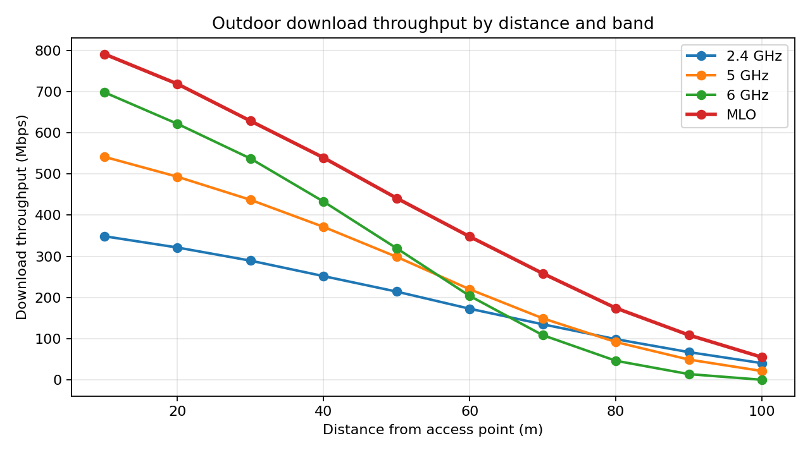
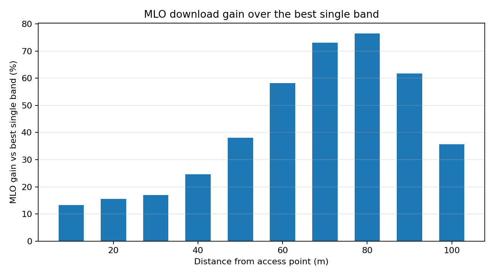

# Wi-Fi 7 Link Quality in Indoor and Outdoor Environments

Final-year research project (BE(Hons) Software Engineering, Auckland University of Technology). Supervisor: Professor Nurul Sarkar.

The study measures how distance, walls, floors and frequency band affect **Wi-Fi 7 (IEEE 802.11be)** link quality, and whether **Multi-Link Operation (MLO)** beats the best single band.

- **Part A, indoor (AUT building):** RSSI and SNR on 2.4, 5 and 6 GHz across a same-room baseline, 1-3 walls, and Floors 2-3 (access point on Floor 1). Tool: NetSpot Pro.
- **Part B, outdoor (William Green Domain, Highland Park):** iPerf3 upload/download throughput plus RSSI/SNR at 10 points from 10 m to 100 m, for 2.4, 5, 6 GHz and MLO.

## Key findings

| Finding | Value |
|---|---|
| Fastest single band up close | 6 GHz, 698.3 Mbps download at 10 m |
| 6 GHz at long range | No connection at 100 m (-93 dBm) |
| 2.4 GHz at long range | Still connected at 100 m (40.4 Mbps) |
| MLO vs best single band | Higher at all 10 points (+13.3% to +76.5%) |
| Peak MLO gain | +76.5% at 80 m (174.2 vs 98.7 Mbps) |
| Indoor, Floor 3 | 6 GHz: -84 dBm, SNR 0.9 dB, no reliable signal |




## Repository structure

```
data/       Measurement tables (CSV) and the derived MLO-gain summary
scripts/    analyse.py: rebuilds the summary table and all figures from data/
figures/    Generated charts
docs/       Final technical report (PDF) and A1 poster (PDF)
raw_logs/   Place for original iPerf3 / NetSpot exports (see raw_logs/README.md)
```

## Reproduce the figures

```bash
pip install -r requirements.txt
python scripts/analyse.py
```

MLO gain is computed as `100 x (MLO download - best single-band download) / best single-band download` at each distance.

## Limitations (read before citing)

- One site and one access point / client pair; results describe the tested setup, not universal range limits.
- The values in `data/` are transcribed from the final report. The original iPerf3 logs and NetSpot exports are not included yet.
- Repeat-run averages and variance are not reported.
- The MLO gain is a descriptive comparison and does not isolate MLO as the sole cause.

## Documents

- [Final technical report](docs/Wi-Fi7_Link_Quality_Final_Report.pdf)
- [A1 poster](docs/Wi-Fi7_Link_Quality_Poster_A1.pdf)

## Author

Santiago Viscarra | [LinkedIn](https://www.linkedin.com/in/santiago-viscarra/) | [GitHub](https://github.com/SantiagoV20)
